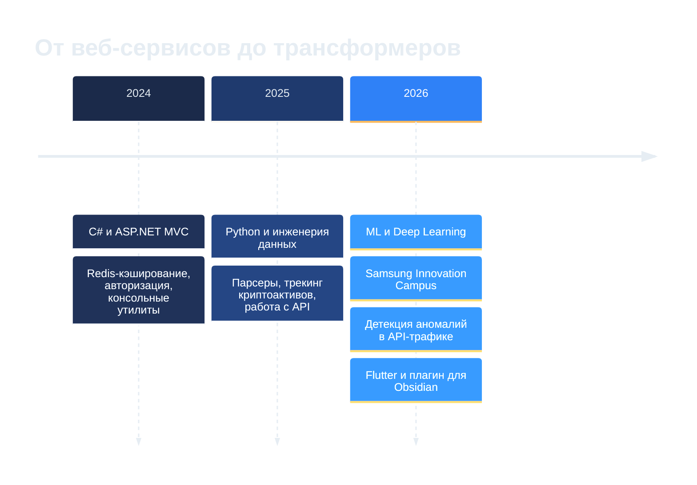

  
  
  

  
  
  

  <a href="#about">Обо мне</a> &nbsp;·&nbsp;
  <a href="#focus">Направления</a> &nbsp;·&nbsp;
  <a href="#journey">Хронология</a> &nbsp;·&nbsp;
  <a href="#stack">Стек</a> &nbsp;·&nbsp;
  <a href="#projects">Проекты</a> &nbsp;·&nbsp;
  <a href="#analytics">Статистика</a> &nbsp;·&nbsp;
  <a href="#roadmap">Roadmap</a> &nbsp;

 

<h2 align="center">Обо мне</h2>

  Привет! Я <b>Максим</b> — студент 4 курса СибГУТИ. Занимаюсь машинным обучением и разработкой на Python: 
  от подготовки данных и обучения моделей до упаковки их в сервис. 
  Сейчас ищу <b>стажировку или junior-позицию</b> по направлениям ML Engineer / AI Developer / Data Scientist.

<table>
  <tr>
    <td><b>Образование</b></td>
    <td>СибГУТИ · 09.03.01 «Информатика и вычислительная техника» · выпуск 2027</td>
  </tr>
  <tr>
    <td><b>Сертификация</b></td>
    <td>Samsung Innovation Campus — Искусственный интеллект и ML (с отличием, 2026)</td>
  </tr>
  <tr>
    <td><b>Текущий фокус</b></td>
    <td>ML-проекты, дипломная работа, мобильное приложение на Flutter</td>
  </tr>
  <tr>
    <td><b>Развитие</b></td>
    <td>ML/DL, backend, Kubernetes (см. <a href="#roadmap">Roadmap</a>)</td>
  </tr>
  <tr>
    <td><b>Локация</b></td>
    <td>Новосибирск · UTC+7</td>
  </tr>
</table>

 

<h2 align="center">Направления</h2>

<table>
  <tr>
    <td align="center" width="33%"><h3>Machine Learning</h3></td>
    <td align="center" width="33%"><h3>Backend &amp; MLOps</h3></td>
  </tr>
  <tr>
    <td valign="top">
      Transformer-модели для последовательностей 
      Градиентный бустинг (CatBoost, LightGBM) 
      Временные ряды и прогнозирование 
      Объяснимый ИИ: attention maps 
      Валидация без утечек данных
    </td>
    <td valign="top">
      FastAPI-сервисы и REST API 
      Docker, Nginx, CI/CD 
      PostgreSQL, Redis 
      Мониторинг: Prometheus 
      Безопасность API (IDOR / BOLA)
    </td>
  </tr>
</table>

 

<h2 align="center">Хронология</h2>

 

<h2 align="center">Стек технологий</h2>

<b>LANGUAGES</b> 

  

<b>ML / DATA SCIENCE</b> 
 

  

<b>BACKEND &amp; WEB</b> 

  

<b>DATABASES &amp; STREAMING</b> 

  

<b>DEVOPS &amp; TOOLS</b> 
 

 

<h2 align="center">Проекты</h2>

### [NeuralIDOR-Det](https://github.com/NuIIX/NeuralIDOR-Det)

| | |
| :-- | :-- |
| **Задача** | Поиск аномального поведения пользователей и ботов в API-трафике, в первую очередь IDOR-подобных обращений к чужим ресурсам |
| **Подход** | Transformer Encoder анализирует последовательности вызовов API, MLP — метаданные (IP, `user_id`, число запросов); признаки объединяются через late fusion. Autoencoder ищет неизвестные типы атак без разметки |
| **Объяснимость** | Attention maps показывают, какие вызовы повлияли на решение |
| **Результат на внешнем наборе** | Accuracy `0.784` · F1 `0.870` · ROC-AUC `0.666` |
| **Честно об ограничениях** | CatBoost-baseline даёт ROC-AUC `0.893`: гибридная модель пока не побеждает по этой метрике. Причины и план разобраны в README проекта |
| **Стек** | Python · Deep Learning · CatBoost · CUDA |

### [Semantic Gardener](https://github.com/NuIIX/obsidian-semantic-gardener)

| | |
| :-- | :-- |
| **Задача** | Находить смысловые дубликаты заметок в Obsidian-хранилище и аккуратно сводить их в атомарные концепты |
| **Подход** | Локальные эмбеддинги (multilingual MiniLM, ONNX) в Web Worker, кластеризация по косинусной близости, проверка дубликата через Gemini (BYOK) |
| **UX** | Human-in-the-loop: пословный diff, принять / изменить / отклонить, откат последнего рефакторинга в один клик |
| **Приватность** | Текст хранилища не покидает машину на этапе сканирования |
| **Стек** | TypeScript · Svelte 5 · Transformers.js · Gemini API · MIT |

<b>Другие публичные репозитории</b>

 

| Проект | Описание | Стек |
| :-- | :-- | :-- |
| [py-cointracker](https://github.com/NuIIX/py-cointracker) | CLI-трекер криптовалют: сбор данных с coinmarketcap.com, хранение, экспорт в CSV / JSON / XML |  |
| [Yeahub-Obsidian-Parser](https://github.com/NuIIX/Yeahub-Obsidian-Parser) | Разбор вопросов и подборок из Yeahub API и форматирование их для Obsidian.md |  |
| [SAMSUNG-HAKATON](https://github.com/NuIIX/SAMSUNG-HAKATON) | Хакатонный проект |  |
| [RedisTutorialProject](https://github.com/NuIIX/RedisTutorialProject) | Redis как кэш в ASP.NET Core MVC, примеры работы с БД и RESTful-сервисами |  |
| [SimpleExampleAuth](https://github.com/NuIIX/SimpleExampleAuth) | Минимальный пример системы аутентификации и авторизации |  |
| [ASCII_Art_Generator](https://github.com/NuIIX/ASCII_Art_Generator) | Преобразование изображения в ASCII-арт |  |

  Часть проектов приватна: ML-прогнозирование, FastAPI-сервисы, Flutter-приложения. Детали по запросу.

<h2 align="center">Статистика</h2>

  

  
  

  

  <picture>
    <source media="(prefers-color-scheme: dark)" srcset="https://raw.githubusercontent.com/NuIIX/NuIIX/output/github-snake-dark.svg" />
    <source media="(prefers-color-scheme: light)" srcset="https://raw.githubusercontent.com/NuIIX/NuIIX/output/github-snake.svg" />
    
  </picture>

<b>Интерактивная карта направлений на roadmap.sh</b>

 

  

  

  Спасибо, что заглянули ⭐ — если проект оказался полезным, поставьте звезду.

